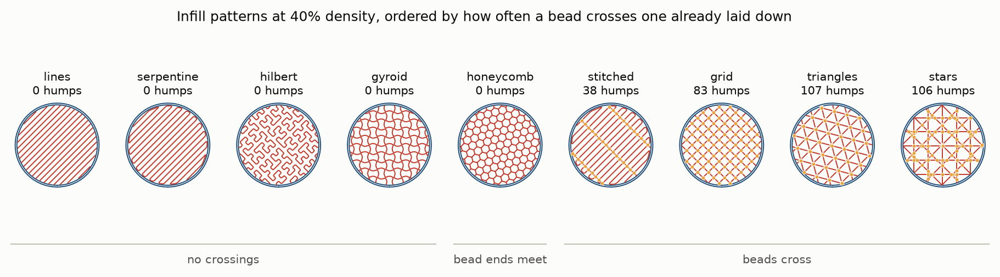
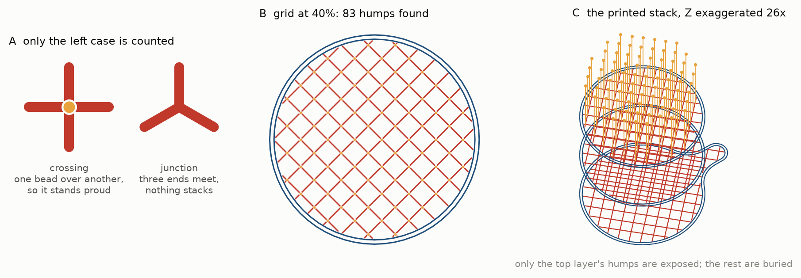
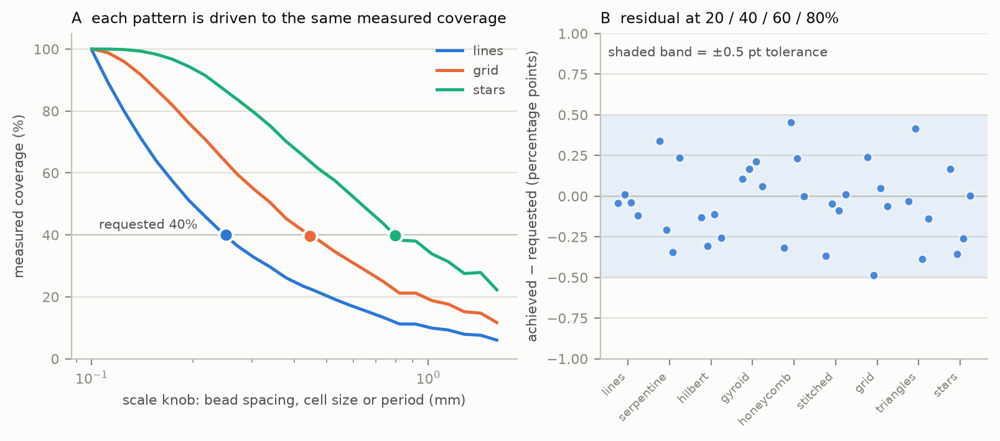
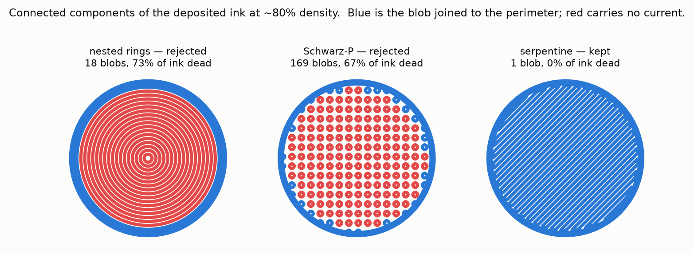
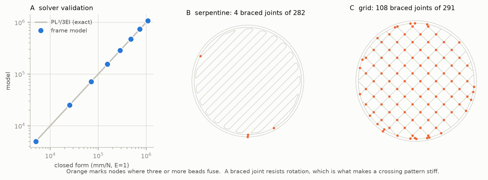
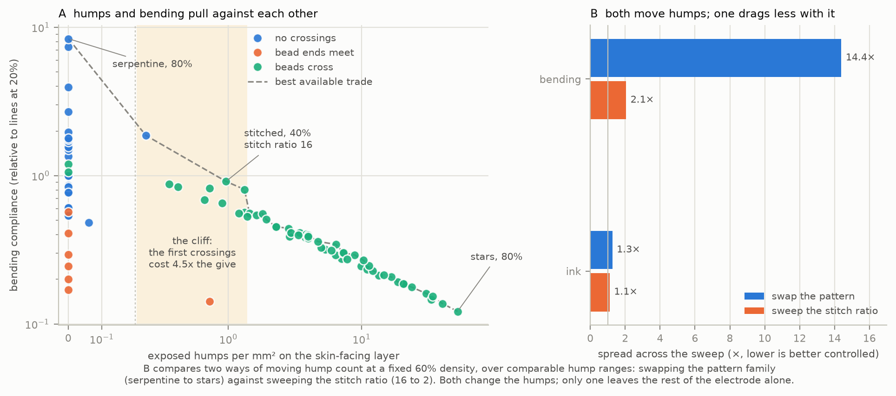

# Printed electrode geometry: slicing, infill, and what was measured

**Methods.** This describes how the peri-orbital electrodes were generated for
printing, and how the geometric and structural quantities used as predictors
were computed. Everything here is upstream of any electrical measurement: it
concerns only what is sent to the printer and what can be derived from that
geometry.

All figures regenerate from the source geometry with
`uv run python docs/make_figures.py`.

---

## 1. Rationale

The working hypothesis is that an infill pattern whose toolpath crosses over
itself leaves discrete raised features at each crossing, and that these act on
the stratum corneum in the manner of a micro-needle array, lowering the
electrode–skin interface impedance. Testing that requires electrodes which
differ in the density of such features while being otherwise comparable.

Two things follow. First, "surface texture" has to become a measured quantity
rather than a description, so that impedance can be regressed against it.
Second, the quantities that would otherwise confound the comparison — how much
conductor is deposited, whether all of it conducts, and how readily the
electrode conforms — have to be measured too, because as shown below none of
them stays constant when the pattern is changed.

## 2. Part and machine

The electrode is a Ø5.0 mm disc, 0.30 mm tall, with a 1.5 mm connection tab on
the lowest 0.10 mm, supplied as a binary STL authored in metres. Parts were
printed on a Voltera NOVA (220 × 300 × 40 mm build volume) dispensing a
**100 µm bead** at a **100 µm layer height**, giving three layers.

Bead width sets both the toolpath spacing and the stroke width written to the
output SVG, so the two cannot diverge. All machine parameters are held in a
single definition and may be overridden per run.

## 3. Slicing

Each layer is sectioned at its mid-height in a shared world frame, so layers
stack in register. Each cross section receives two perimeter loops offset
inward by half-integer multiples of the bead width; the remainder is the
infill region.

Infill beads are clipped to that region and their open ends then extended
0.15 bead widths into the wall, so the two fuse. Extending the ends rather than
enlarging the infill region matters: a closed-loop fill would otherwise gain an
entire extra ring of doubled-up material and appear to overlap far more than a
line fill, for reasons of bookkeeping rather than geometry.

Toolpaths are simplified to 5 µm before being measured or written. An STL
tessellates the Ø5 mm disc into roughly 1400 facets and the slice inherits
every one; emitting them all produced a 9 MB plate of sub-micron moves. At 5 µm
— well below the machine's positioning resolution — the same plate is 570 kB
and every reported figure is unchanged to within 0.1%.

## 4. Infill patterns

Nine fills were used for the sweep, grouped by whether the nozzle passes over
a bead it has already laid down in the same layer (Figure 1). A fully dense
`solid` reference pad and a perimeters-only `none` are also available but are
not part of the crossing axis.

**Figure 1.** All nine fills at 40% density on the skin-facing layer, ordered
by crossing behaviour. Orange marks each bead-over-bead crossing. Blue is the
perimeter, red the infill.

| class | patterns | behaviour |
|---|---|---|
| no crossings | `lines`, `serpentine`, `hilbert`, `gyroid` | no bead is laid over another |
| bead ends meet | `honeycomb` | three bead ends meet at each lattice node |
| beads cross | `stitched`, `grid`, `triangles`, `stars` | the nozzle crosses earlier beads |

`grid`, `triangles` and `stars` are two, three and four families of parallel
lines at 90°, 60° and 45° to one another. `serpentine` joins hatch rows end to
end into one continuous stroke with rounded turns; `hilbert` is a Hilbert
space-filling curve, driven by cell size rather than by curve order so that
density remains continuous rather than quantising in factors of four, clipped
to the part and its pieces rejoined along the edge of the fill region into as
few strokes as the outline allows.
`stitched` is a serpentine carrying the density with a sparse cross-stitch
every *r* rows supplying the crossings, where *r* is an adjustable ratio.

## 5. Measuring the surface texture

A **crossing** is a point where two infill beads intersect away from both of
their endpoints, so that one is deposited on top of the other and the material
stands one layer height proud for each pass beyond the first. A **junction** is
a point where three or more bead *ends* meet: material accumulates, but all of
it at the same height (Figure 2A).

**Figure 2.** (A) The distinction that is counted. (B) The same test applied to
a real fill. (C) The printed stack with Z exaggerated 26×; crossings are drawn
standing proud of the surface.

Crossings are counted on the infill alone. Every pattern terminates its beads
on the perimeter loop, so including the walls would add a near-constant term
that swamps the difference between patterns.

Only the **topmost layer's** crossings are treated as exposed: anything lower
is buried by the layer printed over it and never contacts skin. Reported
`crossings_per_mm²` is therefore a property of the skin-facing layer.

Deposited material is measured separately in two ways, because they are not the
same thing. Total doubled-up footprint includes beads merely running alongside
one another, which produces no raised feature; the volume attributable to
crossings is measured within a one-bead-width window around each crossing. A
pattern can accumulate a great deal of the former with none of the latter —
`honeycomb` at 40% has 26% doubled-up footprint against `grid`'s 10%, yet
nothing stands proud.

## 6. Making density mean one thing

Comparing patterns at "40% infill" is only meaningful if that figure denotes
one quantity. The analytic spacing formula does not deliver this: for *k*
families of beads of width *w* at spacing *s* it predicts coverage *kw/s*, but
overlapping beads at crossings deposit material without adding coverage, so the
achieved fraction falls short by an amount that differs per pattern.

Density is therefore calibrated numerically. Each pattern exposes one scalar
scale knob — a bead spacing, a hexagonal cell circumradius, or a lattice
period — chosen so that coverage falls monotonically as the knob grows. The
slicer measures the actual deposited area within the infill region and drives
the knob to the requested value by bracketing followed by false position in
log space (Figure 3A). Coverage is close to linear in log(scale), so this
converges in a few evaluations where bisection spent a dozen; on a 25-electrode
plate it reduced runtime from 14.4 s to 11.8 s with no change in the result.

**Figure 3.** (A) Measured coverage against the scale knob for three patterns;
filled markers are where the solver lands for a 40% request. (B) Residual
between achieved and requested density for nine patterns at four densities.

Across nine patterns and four densities the residual stays inside ±0.5
percentage points (Figure 3B). Each pattern also declares the knob value below
which it is already solid, so the search does not probe scales at which the
geometry explodes; a test asserts that every pattern is at least 95% covered at
its own declared floor, which prevents that limit from silently putting a
requestable density out of reach.

Where a density genuinely cannot be resolved — a coarse lattice on a 5 mm disc
quantises — the tool reports the shortfall and records what was achieved.
**Analyses should use the achieved density, not the requested one.**

## 7. Patterns excluded on electrical grounds

A printed electrode conducts only through ink that is joined up. Two
crossing-free fills that were initially attractive as controls fail this
outright (Figure 4).

**Figure 4.** Connected components of the deposited ink at ~80% density. Blue
is the component joined to the perimeter and the connection tab; red is
electrically isolated. The two rejected fills are reconstructed here from their
original definitions, as they no longer ship.

Nested concentric rings never touch one another, and a Schwarz-P cross section
breaks into isolated closed loops. At 80% density these strand 73% and 67% of
their ink respectively: an electrode requested at 80% infill would conduct as
though it were far sparser. Neither is correctable by tuning — the
disconnection is structural — so both were removed rather than retained as
options.

The share of stranded ink is reported for every electrode, and the count of
components alone is not sufficient: four nested rings sounds minor where "73%
of the ink is dead" does not. All nine retained fills report zero stranded ink
across the full density range, and this is asserted for the whole pattern set
rather than checked per pattern.

## 8. Structural compliance

Conformability was estimated from geometry alone. In a linear frame model,
Young's modulus and the bead cross section enter as scalar multipliers on the
whole stiffness matrix; setting both to unity leaves quantities that depend
only on how the beads are arranged. **Absolute values are therefore
meaningless, and only ratios between patterns are interpreted.**

Each layer is reduced to a planar frame of Euler–Bernoulli beam elements. Beads
are noded wherever they meet, so a crossing becomes a shared node. Joints are
modelled as rigid, because two beads that cross are fused by the ink and a
rigid joint resists relative rotation where a pinned one would not. Bead ends
overlapping a wall are welded to it, and components whose beads fuse side by
side without their centrelines meeting are bridged — without this the frame
contains free-floating pieces and admits no solution. The in-plane and
out-of-plane problems decouple exactly for a planar frame and are solved from
one assembly.

One edge is clamped and the opposite edge loaded; displacement is taken as the
median over loaded nodes. The median rather than the mean: a toolpath ends in
the occasional pendant stub which carries no load between any two other points,
says nothing about stiffness, and deflects enough to drag a mean up by eight
orders of magnitude.

**Figure 5.** (A) Solver validation against the closed-form cantilever
deflection *PL³/3EI*. (B, C) The frame network for a chain-like and a braced
fill; orange marks nodes where three or more beads fuse.

The solver reproduces *PL³/3EI*, *PL/EA* and the in-plane cantilever to within
floating-point error, is independent of element count as Euler–Bernoulli
elements should be for a straight beam, and reproduces the stiffening effect of
a diagonal brace on a square frame.

**Limitations.** Bonding between layers is not modelled: each layer is analysed
as its own sheet. These figures therefore compare the networks against one
another and are not the bending stiffness of the finished three-layer
laminate. Only linear, small-deflection behaviour is represented.

## 9. Confounds

Three quantities move when the pattern is changed, and all three are recorded
per electrode so they can be entered as covariates.

**Deposited volume is not matched across patterns at a given density.**
Overlapping beads deposit material without adding coverage, so at matched
measured density a crossing pattern walks further than a flat one. Measured
across `lines` … `stars`, the spread in path length is 1.13× at 20% density but
**1.53× at 80%**. At the high end a `stars` electrode lays half again as much
silver as a `lines` electrode of nominally the same density, so impedance
differences there cannot be attributed to surface texture.

**Compliance is strongly anti-correlated with hump count** (Figure 6A, §10).

**Anisotropy** is reported as the length-weighted orientation tensor of the
bead directions; single-family fills are strongly anisotropic and lattices are
close to isotropic.

## 10. The texture–compliance trade, and the experimental axis

Crossings produce raised features and also brace the network: a crossing is a
rigid weld that triangulates the structure. The two therefore cannot be
maximised together (Figure 6A).

**Figure 6.** (A) Exposed humps against bending compliance for nine patterns at
seven densities plus four stitch ratios; the dashed line is the Pareto front.
(B) Two ways of varying hump count at fixed density, and how much else each
one changes.

The relationship is not a smooth slope. Regressing log compliance on log hump
count across the lattice fills gives an exponent of **−0.41**, where a braced
lattice would predict −1.5. What the data show instead is a threshold. Along
the Pareto front, moving from the most compliant crossing-free electrode to the
most compliant one carrying any crossings at all costs a **4.5-fold** reduction
in bending compliance; at a fixed 60% density the same step costs **5.3-fold**.
Further crossings beyond that are comparatively cheap. The design question is therefore not how
many raised features to produce but whether the first can be afforded at all.

This makes the choice of experimental axis consequential (Figure 6B). Varying
hump count by swapping pattern family, at a fixed 60% density, moves bending
compliance by 14.4× and deposited volume by 1.3× alongside it. Varying the same
quantity by sweeping the `stitched` ratio from 16 to 2 covers a comparable
range of hump density while moving compliance by 2.1× and volume by 1.1×.

**The stitch ratio is accordingly the preferred independent variable.** A
recommended design holds density at 60%, sweeps the ratio over {16, 8, 4, 2}
with replicates, and includes a plain `serpentine` at the same density as the
zero-crossing control. Impedance should be regressed on achieved
`crossings_per_mm2`, with `bend_compliance` and `path_length_mm` as covariates;
all three are recorded per electrode in the run manifest.

## 11. Output and reproducibility

Each run emits one SVG in millimetres with each print layer as a separate
group, and a JSON manifest recording, per electrode and per layer: achieved
density, path length, deposited volume, crossing count and density, junction
count, stranded-ink fraction, and where requested the structural compliance
figures. Plate position is recorded so that a physical electrode can be traced
back to its parameters.

Toolpaths are written as stroked centrelines. A filled-outline mode exists for
importers that require it but is not used here: unioning the beads into flat
regions discards the record of one bead having been laid over another, which is
the quantity under test.

Numerical tolerances used throughout: density calibration ±0.5 percentage
points; toolpath simplification 5 µm; crossing coincidence 1 µm; geometric
predicate snapping 0.1 nm, applied only where an exact overlay fails.

The pipeline is one implementation shared by the batch and interactive paths,
covered by 475 tests including closed-form validation of the structural solver
and property tests asserting that every registered pattern is clipped to its
region, responds monotonically to its scale knob, and strands no ink.
